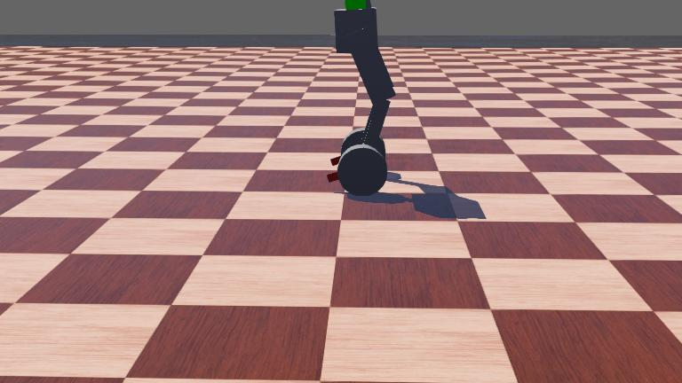
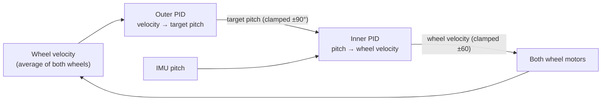
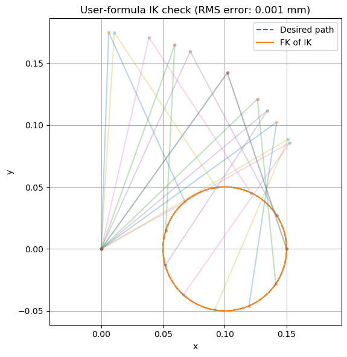

# Wheeled Biped

A two-legged robot with a wheel at the end of each leg: it balances like an inverted pendulum on its wheels and uses its legs to change height. This repo holds the simulation (Webots, ROS 1 and ROS 2 robot descriptions) and the Teensy 4.1 firmware that drives the real motors over CAN bus. The control code is C++, written from scratch.

<p align="center">
  
</p>

## Status

| Part | Where it stands |
|---|---|
| Balance controller (Webots) | **Working.** A cascaded PID balances the robot at a 1 ms time step with no drift, retuned for different leg heights |
| Leg inverse kinematics | **Verified.** Forward kinematics of the IK output reproduces a circular foot path to 0.001 mm RMS error (plot below) |
| CAN motor driver (Teensy 4.1) | **Working on hardware.** Position, velocity and torque commands, onboard PID and acceleration read/write, and encoder zeroing over 1 Mbit/s CAN |
| Foot trajectories on hardware | Circle and square foot paths streamed through IK, with position setpoints streamed at up to 1 kHz |
| IMU | MPU-6050 with DMP fusion, a live 3D visualizer, and a single-motor PID test |
| In progress | Interrupt-driven CAN reads on the Teensy (latest commit), on the way to running the balance loop on hardware |

## Balance controller

There are two PID loops, both in [`wb_control.cpp`](simulation_webot/controllers/wb_control/wb_control.cpp):



- The **inner loop** holds the body upright: it turns pitch error into a wheel velocity command.
- The **outer loop** stops the robot from rolling away: any wheel velocity becomes a small target lean back toward zero velocity. Without it, the robot balances but drifts.
- The legs hold a fixed bend (hip −20°, knee +40°). Gains were retuned for different leg heights, since the height changes the pendulum's dynamics.

## Hardware firmware (`hw/`)

The firmware runs on a Teensy 4.1 with three CAN servo motors and an MPU-6050 IMU.

- **[`motor.hpp`](hw/lib/motor_controller/include/motor_controller/motor.hpp) / [`motor.cpp`](hw/lib/motor_controller/src/motor.cpp):** a driver for the motors' CAN protocol, built on FlexCAN_T4. Values are packed little-endian: signed integers through unsigned casts so two's complement survives, and floats through `memcpy` bitcasts instead of type-punning.
- **[`kinematics.cpp`](hw/lib/motor_controller/src/kinematics.cpp):** closed-form IK for the two-link leg, by the law of cosines. It outputs joint angles in the motor's 0.01° units.
- **[`trajectory.cpp`](hw/lib/motor_controller/src/trajectory.cpp):** time-stepped foot paths (circle, square) and joint sweeps. Each sends a new setpoint on a fixed microsecond schedule.
- **[`imu_class.hpp`](hw/lib/Balancing/imu_class.hpp):** MPU-6050 DMP quaternion → roll/pitch/yaw.

<p align="center">
  
</p>

## Repository layout

```
hw/                  Teensy 4.1 firmware (PlatformIO)
  src/               main.cpp, pid_test.cpp, imu_test.cpp, initialize.cpp (one PlatformIO env each)
  lib/               motor_controller (CAN driver, IK, trajectories), Balancing (IMU, PID),
                     vendored I2Cdev + MPU6050 libraries (Jeff Rowberg, MIT)
  docs/              motor and servo-driver manuals
simulation_webot/    Webots world, robot PROTO/URDF, and the balance controller
simulation_ws/       ROS 1 (catkin): URDF, RViz + Gazebo launch files, simple controller node
simulation_ws2/      ROS 2 (colcon): URDF, RViz + Gazebo launch files
IMU_visualize/       Processing sketch that renders the IMU's orientation live
```

## Build and run

```bash
# Firmware: pick an environment from hw/platformio.ini
cd hw && pio run -e teensy41 -t upload        # or -e pid_test / imu_test / initialization

# Webots: open simulation_webot/worlds/wb_world.wbt; the controller builds from its Makefile

# ROS 2
cd simulation_ws2 && colcon build && source install/setup.bash
ros2 launch simulation gazebo_launch.py
```
